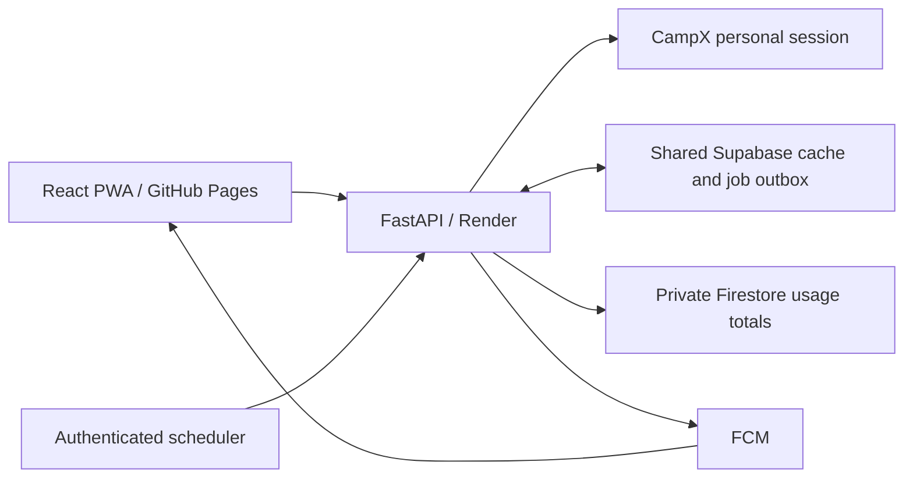

# Rollout and free-service limits

Keep the React PWA on GitHub Pages at `attendance.varmalabs.tech`, use FastAPI on Render, one shared Supabase project for private sessions/cache/jobs, and Firebase only for usage records and opt-in FCM push. Firebase Auth and Google Analytics are not initialized. Accounts belonging to different Gmail addresses work together: configure the correct project IDs, server credentials, IAM permissions and domain; the owner email does not need to match a student's login.

## What changed

- A first-login spotlight tour navigates the real interface, points to actual controls, and responds to clicks. It can be skipped/replayed and stores only a public completion flag locally. Subjects show five recent class results, expandable dates/12-hour times/faculty and local five-row pagination. The current month is shared with Calendar/Playground; at most one previous month is checked automatically on the Subjects page if needed to fill the first five. Further older months load only on user action.
- Navigation and future attendance projections run locally. Fixed corner controls open settings and reveal the selected theme with a circular transition. Reduced-motion/transparency preferences have fallbacks. Existing light/dark color tokens are retained; navigation blur is reduced to 11px.
- Playground supports day-wise and class-wise future attendance choices, overall and subject projections, and the quick calculator. It uses loaded real timetable rows through an explicit end date. It does not guess a semester end, invent missing schedules, edit official marks, or prefetch five months. Choices survive navigation and clear at logout/reload.
- The frontend negotiates `Accept: application/vnd.varmalabs.compact+json`. The dashboard contains summary counts, subjects, calendar status and today's classes. Full month class details stay in a separate private snapshot and load when Subjects, Calendar or Playground needs that month. Legacy clients can still request the full response.
- A short shared cache defaults to 60 seconds, is scoped to verified student/class/semester, and reports original fetch time. Fresh bearer refresh/month hits avoid CampX. Login always authenticates and verifies identity; it can reuse a matching recent snapshot afterward. Cache misses retain six upstream requests at login, five on refresh and three for a selected month.
- Push tokens are encrypted and bound to a verified app session. Database leases prevent competing workers from claiming the same work. Changes atomically create a durable delivery record; failed sends retry with backoff, capped at five claims. FCM can still redeliver after a crash between send and acknowledgement; notification tags reuse the event ID to reduce duplicate display. Delivery is best-effort, not exactly-once.
- Notification content is generic. Opening one reads the authenticated saved dashboard, without another CampX refresh. An expired or reloaded tab needs login. Logout deletes that session's push subscriptions through database cascades. Devices need to opt in again after reconnecting; there is no password vault or automatic indefinite reauthentication.

## Verified in this workspace

On 25 October 2026, the supplied account passed live CampX/Supabase login, compact read, cached on-demand month, encrypted session restoration in a second service instance, logout and cross-instance revocation. The normalized dashboard was **1,788 bytes**, compared with **37,527 bytes** including full month details: **95.2% less JSON** for that account/date. This is an example, not a fixed payload bound. Server-side initial CampX requests still fetch the month.

Both SQL migrations, their repeatability, restricted table/function access, competing claim ownership, idempotent change/outbox insertion, delivery retry claims, quota reservation and expired-session cascades passed in a disposable PGlite PostgreSQL engine. The new migration is now installed remotely: all three new tables are accessible and empty check/delivery worker RPC calls passed. This does not establish hosted high-load capacity.

A synthetic in-process check seeded 2,000 different students, then read their own saved dashboard at concurrency 32: 2,000 HTTP 200 results, zero student mismatches, 4.17 seconds total, median 58.83 ms and p95 81.49 ms in this development machine. Run `python -m scripts.benchmark_cache` to repeat. It uses memory storage and ASGI without network requests; **it does not measure Render, Supabase, CampX, or 2,000 simultaneous real users**. Existing backpressure tests also check that overloaded refreshes fail promptly rather than creating an unbounded queue.

The Firebase default database now responds as Native Firestore. A real verified login wrote pseudonymous parent-user and daily-operation records, and both were read back successfully with server credentials. Anonymous usage reads were rejected with HTTP 403. The provided VAPID public key is configured, and usage/push configuration is enabled in the private development runtime. An FCM dry-run request with a deliberately invalid sample device token returned HTTP 400 INVALID_ARGUMENT; no real device message has been accepted/delivered yet. External cron jobs and Render configuration have not been installed automatically.

A real mobile Chromium session passed login, the first-login tour, calendar time/faculty/status display, subject history, enabled notification settings and logout. The public domain still serves the legacy HTML and the public Render readiness endpoint returns 404. Follow [deploying from your lab](deploy-from-lab.md) to upgrade the server before publishing the React build. No local Python server is required on the lab computer. See [database-choice.md](database-choice.md) for why Supabase remains the operational database.

## Deployment configuration (development prerequisites are now complete)

1. Completed and verified in development: in the Supabase SQL editor for `sknfnvupcgoarfzrfwvl`, run `supabase/migrations/202610250002_notifications_retention.sql`. The first migration is already installed. The new migration adds `push_subscriptions`, `notification_outbox`, `firebase_usage_budget`, atomic worker functions and bounded retention cleanup. `supabase/tests/notifications.sql` is for a disposable database only.
2. Completed and verified in development: as an owner of Firebase project `attendance-90c12`, enable the Cloud Firestore API and create the default Firestore database in Native mode. Choose a suitable region before creating it. Keep Spark/no billing if staying strictly free. Configure document-write permission for the server identity. Keep usage records inaccessible to browser clients; merge the provided `firestore.rules` template with existing rules rather than replacing unrelated policies.
3. The workspace already has a mode-0600 server credential outside Git, referenced by `GOOGLE_APPLICATION_CREDENTIALS`. For Render, use a server Secret File or secure `FIREBASE_SERVICE_ACCOUNT_JSON` setting. Never use a `VITE_` variable for it. Do not deploy the development environment file or the development student's password.
4. On new deployments, keep `FIREBASE_USAGE_ENABLED=false` until a real pseudonymous usage write can be read back by an authorized administrator; then enable it. Parent `usage_users/{uuid}` documents count verified users and logins, and `days/{date}` documents count operations/CampX calls. No email, password, attendance or profile is sent to Firebase. These are operation counts, not exact app-open counts. Metrics may drop on queue overflow, errors or budget exhaustion.
5. The public key is already configured in development. On other deployments, in Firebase Console → Project settings → Cloud Messaging, enable/check the FCM HTTP v1 API and generate/find the **Web Push certificate public key**. Configure it as `FCM_VAPID_PUBLIC_KEY`. The public web configuration is already installed in the private development runtime as `FIREBASE_WEB_CONFIG`; it is returned to the browser only when push is enabled. Do not share the private certificate key.
6. Securely generate `CRON_SECRET` with at least 32 random characters. Set the same value on the backend and scheduler, `NOTIFICATIONS_ENABLED=true`, `NOTIFICATION_BATCH_SIZE=2`, and `NOTIFICATION_INTERVAL_SECONDS=900`. Both Supabase configuration and Firebase server credentials must be present. The feature is off by default outside the configured development runtime and will not prompt for browser permission while disconnected.
7. Create **separate POST jobs** in cron-job.org, each with `Authorization: Bearer <CRON_SECRET>` in its HTTP headers, never in a URL:

   | Endpoint | Pilot schedule | Purpose |
   | --- | --- | --- |
   | `/internal/notifications/run` | Once per minute | Claim a small batch and compare personal attendance |
   | `/internal/notifications/deliver` | Once per minute | Claim and send durable push events |
   | `/internal/maintenance` | Daily | Remove expired sessions/leases, day snapshots after 7 days, month snapshots after 60 days and old delivery records |

   Check/delivery requests have a 25-second server budget to fit cron-job.org's documented 30-second request timeout. Each job has its own lease/retry behavior. Cold Render starts can still exceed the scheduler timeout; inspect failed jobs and provider health. Maintenance works while Firebase/push is disabled if shared storage and `CRON_SECRET` are configured. Cleanup is bounded to 1,000 rows per category per call; repeat after a backlog, and monitor table size. Student profiles/latest dashboards remain until a separate deletion policy is applied.
8. On HTTPS, sign in on a supported device, enable notifications in Settings, send a test, verify receipt/click behavior and confirm a later real attendance correction generates one outbox event. Never generate fake official attendance to test. On iOS/iPadOS, web push requires a supported installed Home Screen app and permission requested from a user action. Browser/device restrictions can delay or block delivery.
9. Deploy the reviewed branch to a staging backend/frontend, verify readiness, CORS, login, month details, both themes and logout, then publish the frontend build manually. This work has not changed the live domain or Render deployment.

Background checks require a valid upstream session and the app session defaults to **two hours without sliding renewal**. Push is not a permanent all-day notification service. Indefinite notifications would need an institution-supported integration or a separately reviewed credential/reauthentication design. There is no verified CampX webhook, so changes are detected by scheduled reads, not instantly when a teacher posts.

## Honest capacity and cost model

Official public limits checked on 25 October 2026:

| Service | Documented free limits relevant here | Consequence |
| --- | --- | --- |
| [Render](https://render.com/docs/free) | 750 free instance hours per workspace/month; idle services spin down after 15 minutes | Two always-running instances do not fit a single workspace's free-hour allowance. Confirm account eligibility/terms before a second instance. Keep-alive pings consume hours and provide no availability guarantee. |
| [Supabase](https://supabase.com/pricing) | 500 MB database, 5 GB ordinary egress, 5 GB cached egress; free projects pause after inactivity | Budget the PostgREST JSON traffic against ordinary egress. Monitor storage/indexes and cleanup. Do not assume unlimited bandwidth because API request count is unlimited. |
| [Firestore](https://firebase.google.com/docs/firestore/quotas) | 1 GiB storage, 50,000 reads/day, 20,000 writes/day, 10 GiB outbound/month | The shared SQL budget caps this app's reservations at 16,000 document writes/day, with Pacific-time quota reset. It excludes background checks; other project apps/console activity still consume quota. No automatic removal of old daily metrics exists yet; monitor storage and plan retention. |
| [GitHub Pages](https://docs.github.com/en/pages/getting-started-with-github-pages/github-pages-limits) | 1 GB site; 100 GB/month soft bandwidth limit | Suitable for public static PWA assets; private data remains on the backend. Keep the existing domain/DNS target and publish `dist` using the manual workflow. |
| [cron-job.org](https://cron-job.org/en/faq/) | Up to once per minute; 30-second request timeout; fair use | Separate checking and delivery jobs; do not use it as an unlimited background compute service. |
| [Firebase web push](https://firebase.google.com/docs/cloud-messaging/js/client) | Supported browsers, HTTPS, permissions, VAPID and service worker required | FCM is no-cost, but it does not eliminate polling/server/database costs or guarantee delivery timing. |

At 2,000 students opening four times a day for 30 days, one 37.5 KB snapshot read per opening is roughly **9 GB/month**, before month views, refreshes or overhead. At 1.8 KB it is about **0.43 GB/month**; adding one full month read per student per day is roughly another **2.25 GB/month**. Those are payload estimates, not a complete provider-billing forecast. Extra refreshes, login verification, PostgREST metadata and polling queries increase traffic. Multiple-server capacity shares the same database quota.

With `NOTIFICATION_BATCH_SIZE=2` and one successful checking job per minute, the ideal ceiling is **120 device checks/hour**, so a 2,000-device sweep needs at least **16.7 hours**, irrespective of a nominal 15-minute due interval. Batch 12 raises the ideal ceiling to 720/hour, still at least 2.8 hours per sweep; slow responses/time budgets reduce it further. Multiple devices consume separate slots, though recent per-student snapshots may avoid repeated CampX calls. Two correctly coordinated servers can share work, but do not create unlimited upstream capacity.

Polling 2,000 students every 15 minutes for eight hours needs 64,000 student checks/day. At five uncached CampX calls per check that is **320,000 upstream requests/day**, besides foreground traffic and database calls. The current free pilot setup is not sized for that. Most valid sessions also expire before such a long sweep finishes. Do not enable notifications for the entire student body and promise prompt delivery with the pilot defaults.

Start with **20–50 consenting testers**, verify actual p95 login/refresh latency, error rates, queue age, active subscriptions, upstream response times, and Supabase egress/storage daily. Increase toward 100, then 250 active users only if quotas, CampX policy and latency remain acceptable. Registered accounts can exceed active-session counts, but 1,000–2,000 simultaneous live refreshes are **not proven supportable on these free instances**. If slow queues persist, reduce optional polling frequency/enrollment or move to institution-approved push/event access and funded compute. Do not issue 2,000 live CampX calls as a load test.

For two servers, use the **same Supabase project, encryption key, session settings, Firebase project and cron secret**. Separate Supabase accounts/databases would split sessions and notification jobs; do not shard by Gmail account. The API service role is server-only and bypasses RLS, so backend authorization remains mandatory. Per-process rate limits currently differ across instances; a distributed limiter and trustworthy proxy configuration are rollout work. A load balancer/failover route is also not configured: the frontend still uses one `VITE_API_BASE_URL`. Adding a second Render service alone does not send it traffic. First pilot one API; add a supported gateway after measuring need, without blindly retrying credential POSTs or bypassing provider limits.

GitHub Education benefits can help with eligible domain/tooling/temporary cloud credits, but eligibility, redemption and expiry must be checked in the student's current Pack dashboard. Do not base permanent reliability on expired Azure credit, rotating accounts, or a promotion. The recommended baseline already uses services that have an ongoing free tier.
